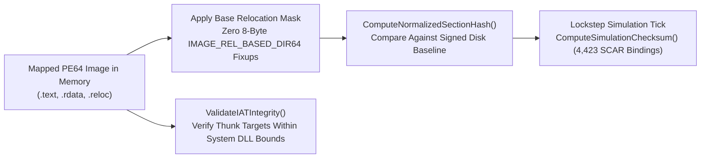

# Audit Preparation & Architecture Package (`AUDIT_PREP.md`)

- **Project:** `cardinal-engine-integrity` (`v1.0.2`)
- **Lead Researcher:** Serhii Shunko (`@sshunko` / `@ccsimplyspolit`, ORCID [`0009-0002-4183-0361`](https://orcid.org/0009-0002-4183-0361))
- **Methodology:** Trail of Bits Audit Preparation Checklist (Static & Dynamic Verification Suite)

---

## 1. Review Goals & Scope

### Security Objectives
1. **Relocation-Normalized `.text` Integrity Verification:** Specify deterministic section hashing that masks ASLR `IMAGE_REL_BASED_DIR64` fixups prior to SHA-256 / FNV-1a digest calculation.
2. **Deterministic Lockstep & SCAR VM Boundary Auditing (4,423 Functions):** Classify all 4,423 SCAR VM bindings across 14 engine subsystems to prevent Out-of-Sync (OOS) simulation desynchronization between peers.
3. **Zero-Dependency PE32+ Header & Section Auditing:** Ensure `tools/cardinal_iat_audit.py` deterministically parses PE64 headers and section tables with or without external `pefile` packages (`3/3 PASS`).

### In-Scope Repository Layout
| Path | Description |
|---|---|
| `docs/engine_integrity_architecture.md` | Architectural specification of `ComputeNormalizedSectionHash` and `ValidateIATIntegrity` |
| `docs/cardinal_engine_vm_and_desync.md` | Deterministic lockstep tick pipeline and rolling 64-bit world-state checksums |
| `docs/scar_checksum_oos_audit.md` | Full 4,423-function SCAR VM boundary classification and OOS serialization audit |
| `docs/unpacker_and_pe_reconstruction.md` | OEP discovery, Virtual-to-Raw alignment restoration, and `.idata` reconstruction |
| `tools/cardinal_iat_audit.py` | PE32+ header, section alignment, and IAT boundary auditor |
| `test_cardinal_iat_audit.py` | Automated unit test suite (`3/3 PASS`) |

---

## 2. Verification & Test Suite Execution

```bash
git clone https://github.com/ccsimplyspolit/cardinal-engine-integrity.git
cd cardinal-engine-integrity
python -m unittest discover -v
```

---

## 3. Relocation-Normalized Integrity & Lockstep Verification Flow


